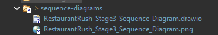

# SC2002 Restaurant Rush — AI Conversation History

**Topic:** GitHub repository requirements, UML documentation, README links, individual AI histories, and EGit workflow  
**Date:** 14 November 2026 (Singapore time)  
**Purpose:** Full conversation record for the SC2002 Restaurant Rush project  

> **Transcription note:** This is a Markdown rendering of the project-related conversation visible in this ChatGPT thread, up to the request to produce this transcript. Tables, rich interface elements, and interactive checklists have been represented using standard Markdown. The screenshot sent during the conversation is included alongside this file. Check the text against the original conversation before submitting it as a formal AI-use record. This is not an official account-data export.

---

## Exchange 1 — Identify missing GitHub repository requirements

### User

Based on the requirements, what are we missing for the github repo

**Files provided:**
- `SC2002-Assignment-main (1)(2).zip`
- `SC2002_Group_Project_Briefing(6).pdf`
- `SC2002_Restaurant_Rush_Group_Assignment(1)(7).docx`

### ChatGPT

I've compared your uploaded **SC2002 Restaurant Rush GitHub ZIP** against the Group Project Briefing and Assignment Requirements.

Your repository is already quite well organised. You have the Java source code, build instructions, stage comparison documents and seven documented functional test scenarios.

However, there are still several items to complete before the **15 November 2026, 11:59 PM (SGT)** submission deadline.

#### 1. GitHub repository checklist

Based on the uploaded ZIP:

| Requirement | Status | Findings |
|---|---|---|
| Java source code | Present | 18 Java source files in `src/` |
| Build and run instructions | Present | Eclipse instructions in `README.md` |
| Stage 1, 2, 3 links | Documented | README links to all three tags |
| GitHub stage comparisons | Documented | Both comparisons linked |
| Stage change explanations | Present | Two detailed Markdown documents |
| Functional testing documentation | Present | Seven scenarios and saved outputs |
| Stage 1 class diagram | Missing | No UML files in ZIP |
| Stage 2 class diagram | Missing | No UML files in ZIP |
| Stage 3 class diagram | Missing | No UML files in ZIP |
| Stage 2/3 sequence diagram | Missing | No sequence diagram in ZIP |
| Individual AI histories | Unverified | README does not link to members' branches |
| Presentation timestamps | Incomplete | Template contains `TBD` |
| Presentation video | Pending | Video link placeholder |
| PDF report | Not in ZIP | Must be included in final submission |
| Signed declarations | Not in ZIP | Required for final submission |

The status reflects the November 11 ZIP snapshot, not necessarily your latest GitHub changes. The ZIP also cannot prove that the actual Git tags or individual branches exist.

#### 2. What you should fix first

**Priority 1 — Upload the four UML diagrams**

Your README currently lists UML diagrams, but the corresponding files are missing from the ZIP.

I recommend adding:

```text
docs/
├── stages/
│   ├── stage-1-to-2.md
│   └── stage-2-to-3.md
└── uml/
    ├── class-diagrams/
    │   ├── stage-1.png
    │   ├── stage-2.png
    │   └── stage-3.png
    └── sequence-diagrams/
        └── stage-3-sequence.png
```

The briefing specifically requires **three class diagrams and one sequence diagram**, matching the appropriate stage's code.

**Priority 2 — Complete individual AI histories**

Your README currently ends with:

`To be completed with each member's GitHub branch and full AI conversation history.`

Each member needs to upload their complete project-related AI conversations, including prompts, responses and follow-up messages, in chronological order on their own branch.

The main README should contain direct links to all members' AI histories. **Do not substitute summaries for full conversations.**

**Priority 3 — Finish the presentation section**

Both `README.md` and `presentation/VIDEO_TIMESTAMPS.md` contain placeholders.

After recording, add the video link, actual timestamps for the seven required segments and every member's presentation contribution.

**Priority 4 — Verify your actual Git tags**

Your README already links to `stage-1`, `stage-2` and `stage-3`, and both comparison documents are written.

However, a GitHub-generated ZIP only contains a source snapshot. It cannot verify the existence of the actual Git tags or whether each historical version compiles independently.

Confirm that each tag exists on GitHub, contains the correct stage-specific implementation and runs successfully.

#### 3. What you have already done correctly

Your `docs/stages/` files are much more detailed than a basic change log. They document new classes, modifications to existing classes, design reasons, OOP considerations and regression testing.

Your testing evidence is also in good shape. I compiled the uploaded Stage 3 Java source and executed the three supplied Stage 3 input scenarios. **All three ran successfully, and their output matched the saved logs.** This verifies those Stage 3 examples, although it does not independently verify the historical Stage 1 and 2 tags.

One small repository organisation issue: the README describes a `docs/uml/` directory and a `report/` directory that are not present in the uploaded ZIP. Create these as needed or update the README to accurately reflect the actual structure.

#### 4. Final submission requirements outside the repository

The assignment also requires a single group submission ZIP containing the source code, README, PDF report, video or accessible video link, and signed declarations.

Make sure the declarations include the group's **Declaration of Original Work** and **each member's Declaration on Use of GAI Assistance**. These are separate from the AI histories stored on GitHub.

I also attempted to access your repository URL externally, but it returned a 404 response. This can happen with private repositories. Make sure your TA can access all relevant GitHub links, tags and individual branches.

#### 5. My suggested order for completion

The response provided an interactive completion checklist. Its items were:

- Upload the three class diagrams — Required design evidence
- Upload the Stage 2/3 sequence diagram — Required design evidence
- Upload all members' AI histories to their branches — Individual GitHub requirement
- Add individual AI-history links to README — Group README requirement
- Verify stage tags and compare links — Historical development evidence
- Add video link and timestamps to README — After recording
- Finish the PDF report and individual reflections — Final submission
- Include all signed declarations — Final submission
- Check grader access and assemble the final ZIP — Final submission

**Overall:** Your main GitHub documentation and testing work are substantially complete. The biggest outstanding repository requirements are the **four UML diagrams, individual AI histories and README links**. After those, your main risks are verifying the historical Git tags and completing the final submission materials.

---

## Exchange 2 — Create folders and update README using Eclipse

### User

Could you walk me through in creating the folders/updating the ReadME for all of the items on the checklist

### ChatGPT

I'll walk you through this using **Eclipse IDE with EGit**, since that's what you're using for your SC2002 project. We won't recreate anything you've already completed.

I've also prepared an updated README using your uploaded repository as the starting point.

**Files provided in the response:**
- `README_UPDATED.md` — Preserves existing project information and adds missing sections
- `VIDEO_TIMESTAMPS_UPDATED.md` — Includes all seven required presentation segments

Both files intentionally contain placeholders for items your group hasn't completed yet.

#### Step 1 — Open your existing repository in Eclipse

Before creating folders, make sure you're editing your actual Git-connected Eclipse project, not the extracted ZIP.

1. Open Eclipse and select your `SC2002_Assignment` project in **Project Explorer**.
2. Go to **Window → Show View → Other → Git → Git Repositories**.
3. Expand your repository and then **Branches → Local**.
4. Make sure you're working on `main` rather than a historical stage tag or a teammate's branch.
5. Save any unfinished changes before switching branches.

#### Step 2 — Create the missing folders

Your uploaded repository already contains `docs/stages/`, `tests/`, `presentation/`, and `src/`.

We only need to expand it.

Target folder structure:

```text
SC2002-Assignment/
├── src/                     # Already exists
├── docs/                    # Already exists
│   ├── stages/              # Already exists
│   └── uml/                 # Create
│       ├── class-diagrams/  # Create
│       └── sequence-diagrams/ # Create
├── tests/                   # Already exists
├── presentation/            # Already exists
├── report/                  # Create (optional in GitHub)
└── README.md                # Update
```

In Eclipse:

1. Right-click `docs`.
2. Select **New → Folder**.
3. Enter `uml` and click **Finish**.
4. Right-click the new `uml` folder.
5. Select **New → Folder** and enter `class-diagrams`.
6. Repeat to create `sequence-diagrams`.
7. Right-click your main project, choose **New → Folder**, and enter `report`.

Git doesn't track empty folders. If you don't have the diagrams or report ready, create a `.gitkeep` or `README.md` file inside those folders for now. You can remove `.gitkeep` after adding actual files.

#### Step 3 — Upload the UML diagrams

According to the briefing, your group needs **three class diagrams and one complex sequence diagram**.

Use these filenames once the diagrams are ready:

| File | Destination |
|---|---|
| `stage-1.png` | `docs/uml/class-diagrams/` |
| `stage-2.png` | `docs/uml/class-diagrams/` |
| `stage-3.png` | `docs/uml/class-diagrams/` |
| `stage-3-sequence.png` | `docs/uml/sequence-diagrams/` |

For every diagram created in draw.io, I recommend saving both its editable `.drawio` file and its exported `.png`.

To add them, drag the files from Windows File Explorer into the corresponding Eclipse folder, select **Copy files** if prompted, and press `F5` to refresh your project.

Make sure the Stage 1 and Stage 2 class diagrams represent the code at their respective Git tags, not the final Stage 3 code.

#### Step 4 — Update your main README

This is where the prepared file will help.

1. Open your existing `README.md` in Eclipse. If necessary, right-click it and select **Open With → Text Editor**.
2. Open the downloaded `README_UPDATED.md` in a text editor.
3. Compare it with your current GitHub version, especially if teammates have made recent changes.
4. Copy the updated sections into your original `README.md`, preserving any newer team edits.
5. Press `Ctrl + S`.

The updated template adds or improves these sections:

- Repository Structure
- UML Diagrams
- Presentation and required timestamps
- Group Members and AI Histories
- Final Group Submission checklist

It preserves your stage links, stage comparison documentation, build instructions, and testing documentation.

Once the UML files are committed, replace the pending file entries in the README with links like:

```markdown
[Stage 1 Class Diagram](docs/uml/class-diagrams/stage-1.png)

[Stage 2 Class Diagram](docs/uml/class-diagrams/stage-2.png)

[Stage 3 Class Diagram](docs/uml/class-diagrams/stage-3.png)

[Stage 3 Sequence Diagram](docs/uml/sequence-diagrams/stage-3-sequence.png)
```

These are relative links, so GitHub should open the correct diagrams automatically after they're uploaded.

#### Step 5 — Update the presentation documentation

You already have `presentation/VIDEO_TIMESTAMPS.md`, so don't create another file.

Open it in Eclipse and replace its content with the prepared updated template.

After the video is recorded, your group will need to fill in the actual timestamps for the game launch, manager decisions, food and payment flow, VIP/Critic behaviour, Stage 3 features, victory/defeat demonstrations, and Git/UML evidence.

**Important:** The assignment specifically asks for the timestamps in the main README, so copy them there too.

#### Step 6 — Create each member's AI-history branch

This is the part that your group members should work on individually.

Do **not** put everybody's AI histories directly into `main`. The briefing says each member must keep their complete project-related conversation history on their own branch.

For your own history:

1. Commit and push your current changes on `main` first.
2. Open **Git Repositories → Branches → Local**.
3. Right-click `main` and choose the option to create a new branch.
4. Give it a clear name such as `ai-member1` (replace with your actual identifier).
5. Enable the option to check out the new branch.
6. Create an `ai-history` folder in your project.
7. Inside it, create `stage-1`, `stage-2`, and `stage-3` folders as relevant.
8. Add Markdown files containing your complete conversations in chronological order.
9. Commit and push those files to your personal branch.

A conversation file could be named `chat-01.md` and structured like this:

```markdown
# Chat 01 — Stage 2 Customer Behaviour

## User
[Original prompt]

## ChatGPT
[Complete response]

## User
[Follow-up question]

## ChatGPT
[Complete follow-up response]
```

Do not shorten the exchanges to summaries. Only include genuine conversations, and check for accidentally exposed passwords, tokens or unrelated private information.

After pushing, return to `main` and update the README's group-member table with the real branch links.

For example, once that branch actually exists:

```markdown
[Member 1 AI History](https://github.com/u-zhaofeng/SC2002-Assignment/tree/ai-member1/ai-history)
```

Each teammate follows the same process on their own branch. You don't need to merge their history branches into `main` as long as the links work and graders can access them.

#### Step 7 — Verify the three stage tags

Your README already includes links for:

- `stage-1`
- `stage-2`
- `stage-3`

Open each link on GitHub and verify that it points to the intended historical implementation.

The assignment requires each tagged version to run independently. If a tag is missing, create it on the correct historical commit, not simply on your current Stage 3 commit.

You already have detailed `stage-1-to-2.md` and `stage-2-to-3.md` files, so there's no need to rewrite those unless your final changes make them inaccurate.

#### Step 8 — Handle the report and declarations

When your group's report is finished, you can place its PDF inside `report/` and commit it to GitHub if desired.

For the final submission ZIP, ensure the PDF report contains the design discussions, functional evidence, all required diagrams and individual reflections.

The signed declarations are also required in the final group ZIP. They don't need to be publicly committed to GitHub, particularly if they contain personal signatures or student details.

#### Step 9 — Commit and push using EGit

After adding the folders and updating the files on `main`:

1. Open **Window → Show View → Other → Git → Git Staging**.
2. Check that the selected branch is `main`.
3. Look under **Unstaged Changes**.
4. Move the new folders' files and modified README into **Staged Changes**.
5. Enter a commit message such as:

   `Add UML documentation structure and update README submission links`

6. Select **Commit and Push**, or commit first and then use **Team → Push to Upstream**.
7. Open GitHub and check that the new files appear on `main`.

If the new folders don't appear on GitHub, check whether they contain tracked files. Git cannot push an empty folder.

#### Step 10 — Final verification

The response contained a checklist with these items:

- `docs/uml/class-diagrams/` exists and contains three class diagrams
- `docs/uml/sequence-diagrams/` contains the complete sequence diagram
- README UML links work
- Existing stage comparison documentation remains intact
- Each member's full AI history is pushed to their own branch
- README links to every member's history branch
- All three stage tags open and run independently
- Video URL and actual timestamps are included in README
- PDF report is included in the final submission ZIP
- All required signed declarations are included
- GitHub links are accessible to graders

**For your next action:** Start with Step 2 in Eclipse—creating the two UML subfolders under `docs/uml/`. Then update your main README using the prepared file. This gets the repository structure and documentation ready without interfering with your working Java game.

---

## Exchange 3 — Link a diagram from README

### User

how do i go about linking my diagram in the UML diagrams under the readme file, can i have the markdown code

### ChatGPT

Yes! You can link your UML diagrams directly in your GitHub `README.md` using Markdown. You can also **display the diagrams directly in the README** instead of requiring the reader to click a link.

Assuming you've followed the folder structure we created earlier, copy this into the **UML Diagrams** section of your `README.md`.

#### 1. Markdown code for your UML diagrams

````markdown
## UML Diagrams

The following UML diagrams illustrate the object-oriented design of our Restaurant Rush game across its three development stages.

### Stage 1 — Class Diagram

[View Stage 1 Class Diagram](docs/uml/class-diagrams/stage-1.png)


### Stage 2 — Class Diagram

[View Stage 2 Class Diagram](docs/uml/class-diagrams/stage-2.png)


### Stage 3 — Class Diagram

[View Stage 3 Class Diagram](docs/uml/class-diagrams/stage-3.png)


### Stage 3 — Sequence Diagram

[View Stage 3 Sequence Diagram](docs/uml/sequence-diagrams/stage-3-sequence.png)


````

#### 2. Difference between a link and an embedded image

**Option A — Clickable link**

```markdown
[View Stage 3 Class Diagram](docs/uml/class-diagrams/stage-3.png)
```

Appears as: [View Stage 3 Class Diagram](https://github.com/u-zhaofeng/SC2002-Assignment/blob/main/docs/uml/class-diagrams/stage-3.png)

**Option B — Display the diagram directly**

```markdown

```

This displays the actual image inside the README.

I recommend **using both**, as shown in the first code block. Your TA can view the diagrams while scrolling through the README or open them separately for a closer look.

#### 3. Important: Your filenames must match

Your GitHub repository should contain:

```text
SC2002-Assignment/
│
├── README.md
│
└── docs/
    └── uml/
        ├── class-diagrams/
        │   ├── stage-1.png
        │   ├── stage-2.png
        │   └── stage-3.png
        │
        └── sequence-diagrams/
            └── stage-3-sequence.png
```

If your diagram is named `Stage3ClassDiagram.png` instead of `stage-3.png`, you must change the Markdown path accordingly.

#### 4. How to check that it works

1. Open `README.md` in Eclipse.
2. Paste the Markdown under your UML Diagrams heading.
3. Save with `Ctrl + S`.
4. Stage, commit and push your changes using EGit.
5. Open your GitHub repository.
6. Scroll to the UML Diagrams section.

You should see all four UML diagrams displayed directly in the README.

**One additional suggestion:** Since you're using draw.io, upload the original `.drawio` files alongside the PNGs. This allows your groupmates and TA to inspect or edit the diagrams if necessary.

---

## Exchange 4 — Link a diagram with its actual filename

### User

say I have png file with a name like this, how do i link it

**Attachment:** Screenshot showing the PNG file named `RestaurantRush_Stage3_Sequence_Diagram.png`.



### ChatGPT

Since your PNG file is named `RestaurantRush_Stage3_Sequence_Diagram.png` and is located inside `docs/uml/sequence-diagrams/`, you can use the following Markdown in your `README.md`.

#### Option 1 — Clickable link

```markdown
### Stage 3 — Sequence Diagram

[View Stage 3 Sequence Diagram](docs/uml/sequence-diagrams/RestaurantRush_Stage3_Sequence_Diagram.png)
```

#### Option 2 — Display the image directly in README

```markdown
### Stage 3 — Sequence Diagram


```

#### Option 3 — Both (recommended)

Copy and paste this:

```markdown
### Stage 3 — Sequence Diagram

This sequence diagram illustrates the interactions between the manager, restaurant staff, and other objects during a Stage 3 gameplay scenario.

[View Stage 3 Sequence Diagram](docs/uml/sequence-diagrams/RestaurantRush_Stage3_Sequence_Diagram.png)


```

**Important:** This assumes your `README.md` is in the project root and your image is inside `docs/uml/sequence-diagrams/`.

After saving, commit and push both your README and PNG file to GitHub. The image should then appear directly in your repository's README.

---

## Exchange 5 — Keep the UML diagrams as a README table

### User

what if it is in this format

```markdown
**## UML Diagrams**

\| Diagram | Stage |
\|---|---|
\| Class Diagram 1 | Stage 1 |
\| Class Diagram 2 | Stage 2 |
\| Class Diagram 3 | Stage 3 |
\| Sequence Diagram | Stage 2 or Stage 3 |
```

### ChatGPT

You can keep your existing table format and simply **turn the diagram names into clickable links**.

Copy and paste this into your `README.md`:

```markdown
## UML Diagrams

| Diagram | Stage |
|---|---|
| [Class Diagram 1](docs/uml/class-diagrams/stage-1.png) | Stage 1 |
| [Class Diagram 2](docs/uml/class-diagrams/stage-2.png) | Stage 2 |
| [Class Diagram 3](docs/uml/class-diagrams/stage-3.png) | Stage 3 |
| [Sequence Diagram](docs/uml/sequence-diagrams/RestaurantRush_Stage3_Sequence_Diagram.png) | Stage 3 |
```

#### How it will look on GitHub

| Diagram | Stage |
|---|---|
| Class Diagram 1 | Stage 1 |
| Class Diagram 2 | Stage 2 |
| Class Diagram 3 | Stage 3 |
| Sequence Diagram | Stage 3 |

Each diagram name will be clickable once the Markdown is in your GitHub README.

**Important:**

- The sequence diagram link uses your exact PNG filename from the screenshot.
- The class diagram filenames (`stage-1.png`, etc.) are examples. Replace them with your actual filenames.
- Use `## UML Diagrams` instead of `**## UML Diagrams**` because `##` already creates a Markdown heading.
- Don't put backslashes (`\`) before the table's vertical bars (`|`).

**My recommendation:** Keep the table format. It's cleaner for your SC2002 GitHub README, especially since you have four diagrams to present.

---

## Exchange 6 — Recheck remaining items

### User

okay done, what else am i missing

### ChatGPT

Now that you've updated the UML diagrams table, you're getting close to completing the GitHub requirements.

I checked your [live GitHub repository](https://github.com/u-zhaofeng/SC2002-Assignment) again. Here is what's left as of **14 November 2026**.

#### Updated completion checklist

| Requirement | Status |
|---|---|
| Java source code | Done |
| README build instructions | Done |
| Stage 1, 2 and 3 Git tags | Exist on GitHub |
| Stage comparison documentation | Done |
| Testing documentation | Present |
| UML diagrams and README links | Local changes not yet visible on `main` |
| Individual AI histories | Not found on member branches |
| README links to AI histories | Missing |
| Presentation video link | Missing |
| Video timestamps | Missing |
| PDF report | Not in repository |
| Signed declarations | Not verified |

The online README still shows the original UML table without links, and the `docs/uml/` folder isn't visible on `main` yet. This suggests you may need to **commit and push your latest changes from Eclipse**.

#### What I recommend doing next

**1. Commit and push your UML diagrams and README**

Make sure the PNG files and modified README appear together on GitHub. Open the links to check that all four diagrams display correctly.

**2. Upload each member's AI conversation history**

This is your biggest remaining GitHub-specific requirement.

Each member needs their own branch containing their complete project-related AI conversations. The main README must link to every member's history.

**3. Update your presentation section**

Once the video is ready, replace `Video link: To be added` and insert the seven required segment timestamps into the README.

**4. Prepare the final submission ZIP**

Include the PDF report, individual reflections, video or accessible link, source code, README and signed declarations. The PDF and declarations don't necessarily have to be committed to GitHub.

#### Let's continue with the AI histories

Since you've been using Eclipse and EGit, I recommend we tackle **Step 2: Individual AI Histories** next, after pushing your UML updates.

I'll guide you through creating your personal branch, organising your ChatGPT conversations into Markdown files, uploading them through Eclipse, and adding the correct links to your main README.

Your deadline is **tomorrow, 15 November 2026, at 11:59 PM Singapore time**, so I'd prioritise getting the AI histories uploaded and the final submission materials ready.

---

## Exchange 7 — Ask whether individual folders are required

### User

do i need to create individual ai history folder

### ChatGPT

**Yes. According to your SC2002 Group Project Briefing, each member must upload their individual AI conversation history to their own GitHub branch.**

However, **you do not need to create a separate AI-history folder for every member on the `main` branch.**

#### Recommended folder structure

Each member should have their own branch containing an `ai-history/` folder.

For example, on your personal branch:

```text
SC2002-Assignment/
├── src/
├── docs/
├── tests/
├── ai-history/
│   ├── stage-1/
│   │   └── chat-01.md
│   ├── stage-2/
│   │   └── chat-01.md
│   └── stage-3/
│       ├── chat-01.md
│       └── chat-02.md
└── README.md
```

Your teammates would follow the same structure on their respective branches.

#### What exactly is required?

| Item | Required? |
|---|---|
| Individual GitHub branch for each member | Yes |
| `ai-history/` folder on each member's branch | Recommended |
| Full AI prompts and responses | Yes |
| Follow-up conversations in chronological order | Yes |
| Separate folders for each stage | Recommended |
| Links to each member's branch in the main README | Yes |
| Merging everyone's AI histories into `main` | No |

The briefing explicitly states that each member must preserve their full project-related AI conversations, not just summaries.

#### What should you do next in Eclipse?

Since you're using EGit, the next steps are:

1. Make sure your latest `main` changes are committed and pushed.
2. Create your personal branch, such as `ai-yourname`.
3. Switch to that branch.
4. Create the `ai-history/` folder.
5. Add your AI conversations as `.md` files.
6. Commit and push your personal branch.
7. Switch back to `main`.
8. Add your personal branch link to the main README.

**My recommendation:** Create the AI-history folder only on your personal branch. Have every groupmate do the same on theirs. This will keep your main repository organised while meeting the assignment requirements.

If you're ready, we can start with **creating your personal AI-history branch in Eclipse**, one step at a time.

---

## Exchange 8 — Detailed EGit instructions for an AI-history branch

### User

okay how do i do that

### ChatGPT

I'll guide you through creating your **personal AI-history branch in Eclipse using EGit**, then creating the folders for your ChatGPT conversations.

We'll keep your team's `main` branch unchanged.

#### Step 1 — Make sure you're on the main branch

1. Open **Eclipse IDE**.
2. Open your `SC2002_Assignment` project.
3. Go to **Window → Show View → Other**.
4. Expand **Git → Git Repositories**.
5. Click **Open**.
6. Expand your repository, then **Branches → Local**.

You should see something similar to:

```text
Branches
├── Local
│   ├── main
│   └── repo-reorganization
└── Remote Tracking
    └── origin/main
```

Check that `main` is your currently checked-out branch.

If it isn't, right-click `main` and select **Checkout**.

Before switching branches, commit or safely save any unfinished changes. You don't want to accidentally carry uncommitted changes into your AI-history branch.

#### Step 2 — Create your personal branch

1. Under **Branches → Local**, right-click `main`.
2. Select **Create Branch...**
3. Enter your preferred branch name.

For example:

```text
ai-history-yourname
```

4. Check **Checkout new branch**.
5. Click **Finish**.

Eclipse should now switch to your newly created branch.

**Important:** Do not delete or modify the existing `main`, `stage-1`, `stage-2`, or `stage-3` references.

#### Step 3 — Create your AI-history folders

Now, in **Project Explorer**:

1. Right-click your project.
2. Select **New → Folder**.
3. Enter `ai-history`.
4. Click **Finish**.
5. Right-click `ai-history` and create a folder named `stage-1`.
6. Repeat for `stage-2` and `stage-3`.

Your project should look like this:

```text
SC2002_Assignment/
├── src/
├── docs/
├── tests/
├── presentation/
├── ai-history/
│   ├── stage-1/
│   ├── stage-2/
│   └── stage-3/
└── README.md
```

#### Step 4 — Create your AI conversation files

Suppose you used ChatGPT to help with your Stage 3 implementation.

1. Right-click `ai-history/stage-3`.
2. Select **New → File**.
3. Enter `chat-01.md`.
4. Click **Finish**.

Copy your original ChatGPT conversation into the file, including the complete prompts, responses and follow-ups, in chronological order.

For example, the document can look like:

```markdown
# Stage 3 — ChatGPT Conversation 1

## User
How should we implement the Happy Hour feature
without modifying too much existing code?

## ChatGPT
[Full original response]

## User
How can we apply the discount after the VIP discount?

## ChatGPT
[Full original follow-up response]
```

The example above is only a formatting guide. Your actual submission should contain the genuine full conversation, rather than reconstructed or summarised responses.

Save using `Ctrl + S`.

Repeat for every project-related AI conversation you used, organising them by stage where applicable. The briefing requires complete histories, including follow-up exchanges.

#### Step 5 — Commit your AI-history files

Once you've added your conversations:

1. Go to **Window → Show View → Other → Git → Git Staging**.
2. Under **Unstaged Changes**, locate your `ai-history/` files.
3. Move them into **Staged Changes**.
4. Enter this commit message:

```text
Add individual AI conversation history
```

5. Click **Commit**.

#### Step 6 — Push your personal branch to GitHub

Because this is a new local branch, you'll need to publish it.

1. Right-click your project.
2. Select **Team → Push Branch...** (wording may differ by EGit version).
3. Select the existing `origin` remote.
4. Confirm that the destination branch is `ai-history-yourname`.
5. Click **Next**, review the push, and select **Finish**.

If Eclipse offers **Commit and Push** directly and successfully sets up the remote branch, you can use that instead.

Open your GitHub repository and use the branch dropdown to select your personal branch. Verify that the `ai-history` folder and Markdown files are visible.

#### Step 7 — Link your branch in the main README

After successfully pushing your personal branch:

1. Switch back to `main` in Eclipse.
2. Open the main `README.md`.
3. Find **Group Members and AI Histories**.
4. Add a Markdown table like this:

```markdown
## Group Members and AI Histories

Each member's full project-related AI conversations
are documented in their respective GitHub branches.

| Member | AI Conversation History |
|---|---|
| Member 1 | [View AI History](https://github.com/u-zhaofeng/SC2002-Assignment/tree/ai-history-member1/ai-history) |
| Member 2 | [View AI History](https://github.com/u-zhaofeng/SC2002-Assignment/tree/ai-history-member2/ai-history) |
| Member 3 | [View AI History](https://github.com/u-zhaofeng/SC2002-Assignment/tree/ai-history-member3/ai-history) |
```

Replace each example branch name with the corresponding real branch name, and add a row for every group member.

Commit and push the README changes on `main`.

#### Your progress checklist

The response included an interactive checklist with these items:

- Confirm main is checked out and clean
- Create and check out personal branch
- Create ai-history stage folders
- Add complete conversation files
- Commit conversation files
- Push personal branch to GitHub
- Verify folder on GitHub
- Return to main and add README link
- Commit and push README

**Start with Steps 1 and 2:** Open Git Repositories in Eclipse, right-click `main`, and create your personal branch with **Checkout new branch** enabled. Once you've done that, your next action is creating the `ai-history` folder under your project.

---

## Exchange 9 — Publish this ChatGPT conversation to GitHub

### User

say i wanna publish this chat to the history, how do i go about doing it

### ChatGPT

You can publish **this entire ChatGPT conversation** into your personal AI-history branch on GitHub. For your SC2002 assignment, I recommend exporting the conversation rather than manually copying every message.

The important thing is to preserve **your prompts, my responses, and all follow-up exchanges in chronological order**.

#### Step 1 — Export this ChatGPT conversation

On your computer:

1. Open this conversation in ChatGPT.
2. Click the **Share** button near the top-right corner.
3. Look for an option to copy the conversation text or export it, if available.
4. If there is no export option, select and copy the conversation messages manually.

**Important:** A ChatGPT shared link alone is not sufficient for your assignment because the briefing requires the conversation history to be uploaded into your GitHub branch.

You can also use **Settings → Data Controls → Export Data** to request a copy of your ChatGPT data. However, this exports your account's conversation data rather than just this chat.

#### Step 2 — Create a Markdown file in Eclipse

Assuming you've already created your personal AI-history branch, navigate to:

`SC2002_Assignment → ai-history`

Since this conversation mainly concerns GitHub repository organisation and submission requirements, I recommend keeping it in a separate folder rather than assigning it to an implementation stage.

For example:

```text
ai-history/
├── stage-1/
├── stage-2/
├── stage-3/
└── project-documentation/
    └── github-setup-chat.md
```

In Eclipse, right-click `ai-history`, select **New → Folder**, and name it `project-documentation`.

Then right-click the new folder, select **New → File**, and enter:

`github-setup-chat.md`

#### Step 3 — Paste the full conversation

Use a structure like this:

```markdown
# AI Conversation History — GitHub Repository Setup

## Purpose
Discussion regarding the organisation, documentation,
UML diagrams, README updates, and GitHub submission
requirements for the SC2002 Restaurant Rush project.

---

## Conversation Transcript

### User
Based on the requirements, what are we missing
for the github repo?

### ChatGPT
[Paste the complete original response here]

---

### User
Could you walk me through in creating the
folders/updating the ReadME for all of the items
on the checklist

### ChatGPT
[Paste the complete original response here]

---

### User
how do i go about linking my diagram in the
UML diagrams under the readme file,
can i have the markdown code

### ChatGPT
[Paste the complete original response here]

---

[Continue with every remaining exchange in order]
```

The text above is just a template. **Do not replace the full AI replies with summaries or placeholders in your actual submission.**

Also include the remaining messages in this conversation, including this explanation, if you're submitting the conversation in full.

#### Step 4 — Commit and push to your personal branch

In Eclipse:

1. Press `Ctrl + S` to save the Markdown file.
2. Open **Git Staging**.
3. Stage `github-setup-chat.md`.
4. Enter the commit message `Add AI history for GitHub repository documentation`.
5. Click **Commit and Push**.

Make sure you're on your personal AI-history branch, not `main`.

#### Step 5 — Link it in the README

After pushing, add a link under **Group Members and AI Histories** in the main README.

For example, assuming your branch is named `ai-history-yourname`:

```markdown
[GitHub Setup Conversation](https://github.com/u-zhaofeng/SC2002-Assignment/blob/ai-history-yourname/ai-history/project-documentation/github-setup-chat.md)
```

Replace `ai-history-yourname` with the actual branch name.

#### Another option: Download this conversation as a PDF

If you prefer a PDF, you can use your browser's **Print → Save as PDF** function, provided the full conversation is loaded.

You could then save it as:

`ai-history/project-documentation/github-setup-chat.pdf`

A PDF can be committed to GitHub just like a Markdown file. However, **Markdown is my recommendation** because your TA can easily view and search through the conversation directly on GitHub.

For this particular chat, the PDF approach may be easier because there are many messages, Markdown tables and code blocks to preserve.

---

## Exchange 10 — Request a ready-to-upload Markdown transcript

### User

based on our current chat could you give me a markdown for it

### ChatGPT

I prepared this Markdown transcript of the conversation so far, with each user prompt and the corresponding ChatGPT reply arranged in chronological order. Interactive visual elements have been converted to readable Markdown, and the screenshot is included as a separate file. The transcript is a best-effort rendering from the messages visible in this conversation and should be checked against the source chat before submission.

---

**End of transcript at time of export.**
